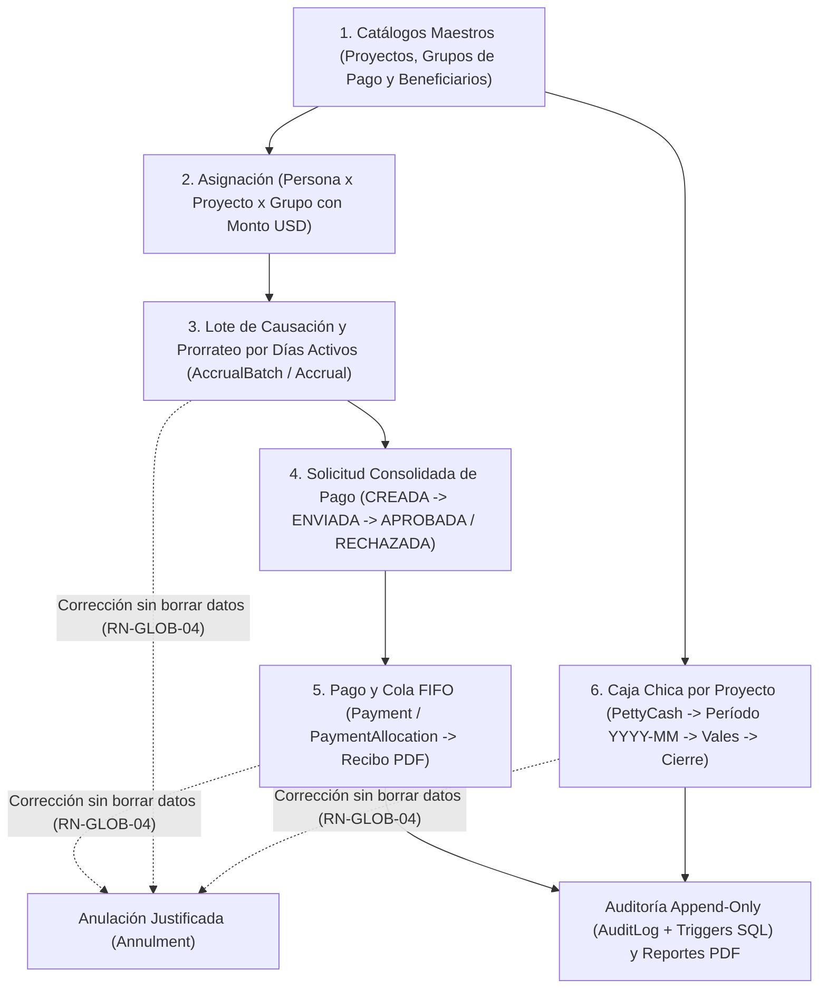

# Glosario y Explicación del Modelo de Negocio (SCPA — FACYT)

**Universidad de Carabobo — Facultad Experimental de Ciencias y Tecnología (FACYT)**  
**Asignatura:** Sistemas de Información  
**Proyecto:** Sistema de Control de Pagos y Asignaciones (USD)

> **Propósito de este documento:**  
> Explicar en lenguaje claro, con ejemplos numéricos y trazabilidad directa hacia el código y la base de datos, **cada término, concepto financiero, rol y flujo operativo** del modelo de negocio definido en [`REGLAS_DE_NEGOCIO.md`](./REGLAS_DE_NEGOCIO.md) y [`schema.prisma`](../backend/prisma/schema.prisma). Sirve tanto como guía de estudio para la defensa académica como referencia funcional para usuarios y desarrolladores.

---

## 1. Visión General y Principios Rectores (`RN-GLOB`)

El **Sistema de Control de Pagos y Asignaciones (SCPA)** administra el dinero devengado y pagado a investigadores, profesores, técnicos y asistentes que participan en proyectos científicos de **Física, Química y Biología**, además del gasto menor operativo manejado mediante **Cajas Chicas**.



Todo el modelo descansa sobre **cuatro invariantes financieras globales**:

1. **Moneda Única y Montos Netos (`RN-GLOB-01`):** Todas las cifras se expresan exclusivamente en **Dólares Estadounidenses (USD)**. El modelo del proyecto no contempla conversiones multimoneda ni deducciones legales de nómina tradicional (ISLR, SSO, FAOV); lo que se asigna y prorroga es el monto bruto/neto a entregar.
2. **Precisión Decimal Exacta (`RN-GLOB-02`):** En contabilidad y finanzas, la aritmética binaria flotante (`float`/`double`) produce errores de centavos (como `0.1 + 0.2 = 0.30000000000000004`). Por eso:
   - En PostgreSQL toda columna monetaria es `NUMERIC(12, 2)` (hasta diez mil millones con 2 decimales exactos).
   - En el Backend (`NestJS`), todos los cálculos usan `Decimal.js` con redondeo financiero estándar a 2 decimales (`ROUND_HALF_UP`, donde `0.005` redondea hacia arriba a `0.01`).
3. **Inmutabilidad Contable (`RN-GLOB-03`):** Una vez emitido un registro con impacto financiero (**Causación**, **Lote**, **Solicitud**, **Pago**, **Imputación FIFO** o **Vale de Caja Chica**), **no existe eliminación física (`DELETE`) ni edición directa de sus montos base (`UPDATE` de montos)**. En PostgreSQL esto está reforzado físicamente mediante triggers `BEFORE DELETE` (`fn_block_financial_deletion`) y `BEFORE UPDATE` sobre montos originales (`fn_block_financial_amount_mutation`) en [`03_audit_triggers.sql`](../database/03_audit_triggers.sql).
4. **Anulación Justificada como Único Mecanismo de Corrección (`RN-GLOB-04`):** Los errores reales de operación nunca se "borran del mapa"; se registran mediante una **Anulación Justificada** con motivo obligatorio (mínimo 10 caracteres), autor y reversión contable matemática dentro de una transacción atómica.

---

## 2. Actores, Roles y Segregación de Funciones (`RN-SEG`)

El sistema distingue estrictamente entre **quien opera la aplicación** y **quien recibe el dinero**.

### 2.1 Usuario Operador vs. Beneficiario (`RN-SEG-01`)

| Concepto | Tabla / Entidad | ¿Inicia sesión? | Significado en el negocio |
| :--- | :--- | :---: | :--- |
| **Usuario Operador** | `users` (`User`) | ✅ Sí (JWT) | Funcionario administrativo o coordinador que registra, aprueba, paga o audita operaciones dentro del sistema. |
| **Beneficiario** | `beneficiaries` (`Beneficiary`) | ❌ **No** | Investigador, docente, técnico o asistente que recibe pagos por su participación en proyectos. No tiene contraseña ni acceso al sistema; se identifica por su cédula (`dni` único) y datos bancarios (`bank_info`). |

### 2.2 Los 3 Roles Segregados (`RN-SEG-02`)

La segregación de funciones evita que una misma persona pueda crear un gasto, aprobarlo y pagarse/pagar sin control cruzado (**"quien solicita no aprueba ni desembolsa"**):

* **`ADMIN` (Administrador del Sistema):**
  * *Qué gobierna:* Usuarios (`users`), parámetros globales (`system_parameters`), bitácora forense (`audit_logs`) y mantenimiento de catálogos base (proyectos, grupos de pago, fechas de corte y beneficiarios).
  * *Qué NO puede hacer:* Participar en ninguna operación de dinero (no crea asignaciones salariales, no genera causaciones, no crea/aprueba solicitudes, no registra pagos ni opera cajas chicas). Sus endpoints financieros responden `HTTP 403 Forbidden`.
* **`GENERADOR` (Coordinador General / Generador de Nómina):**
  * *Qué gobierna:* Catálogo de proyectos y beneficiarios, **Asignaciones**, ejecución del **Motor de Causación por Lote**, creación y envío de **Solicitudes de Pago**, anulación de causaciones/solicitudes sin pagos, y ciclo operativo de origen en **Cajas Chicas** (crear caja, solicitar apertura mensual, solicitar vales y rendir facturas).
  * *Qué NO puede hacer:* Aprobar solicitudes propias, registrar pagos, aprobar aperturas/vales, desembolsar dinero ni cerrar cajas chicas.
* **`RECEPTOR` (Gerente de Administración / Receptor de Nómina):**
  * *Qué gobierna:* Control financiero y tesorería. **Aprueba o rechaza** solicitudes enviadas, **registra entregas de fondos (pagos FIFO)**, cierra solicitudes pagadas al 100%, anula pagos entregados y, en **Caja Chica**, aprueba aperturas, aprueba/rechaza vales, desembolsa el efectivo, cierra períodos mensuales y cierra cajas definitivamente. También consulta reportes y auditoría (`audit_logs`).
  * *Qué NO puede hacer:* Crear/editar catálogos base, crear asignaciones ni emitir nuevas causaciones.

---

## 3. Catálogos Maestros y Vínculo Operativo (`RN-CAT`)

### 3.1 Proyecto (`Project` / `projects` — `RN-CAT-01`, `RN-CAT-02`)
Representa la unidad científica o administrativa que origina asignaciones y gastos. Cada proyecto posee:
* **Código único** (autogenerado según área y año, ej. `FIS-2026-01`, o ingresado manualmente en mayúsculas).
* **Área científica obligatoria (`ProjectArea`):** `FISICA`, `QUIMICA` o `BIOLOGIA`.
* **Ámbito (`ProjectScope`):** `INTERNO` (recursos internos de la facultad/universidad) o `EXTERNO` (financiamiento o convenios externos).
* **Vigencia:** Rango de fechas `[start_date, end_date]` con `start_date <= end_date`.
* **Estado (`ProjectStatus`):**
  * `ACTIVO`: permite crear asignaciones y generar nuevas causaciones dentro de su vigencia.
  * `INACTIVO` / `CERRADO`: **bloquea nuevas asignaciones y nuevas causaciones (`RN-CAT-02`)**, pero **sí permite aprobar solicitudes y pagar deudas que ya fueron causadas válidamente antes del vencimiento o cierre**. Esto garantiza que un investigador nunca pierda un pago ya devengado porque el proyecto cerró administrativamente después.

### 3.2 Grupo de Pago (`PaymentGroup` / `payment_groups`) y Fechas de Corte (`PaymentGroupPeriod` — `RN-CAT-03`)
Define el calendario de cobro con que trabaja un equipo o tipo de personal:
* **Periodicidad (`Periodicity`):** `SEMANAL` (cortes de ~7 días cerrando fin de mes), `QUINCENAL` (1–15 y 16–fin de mes) o `MENSUAL` (primer al último día real del mes).
* **Reglas de corte (`cutoff_rules`):** Descripción textual operativa del calendario.
* **Períodos de corte (`payment_group_periods`):** Al crear un grupo, el sistema genera automáticamente sus cortes estándar para el año actual y el siguiente (ej. 24 quincenas por año = 48 períodos). Además, el `ADMIN` puede agregar **cortes personalizados** (siempre sin solaparse) o eliminar cortes no usados en ningún lote. Cuando un grupo tiene períodos configurados, todo lote de causación debe coincidir exactamente con uno de esos cortes.

### 3.3 Asignación (`Assignment` / `assignments` — `RN-CAT-04`)
Es el contrato operativo que vincula a **un Beneficiario** con **un Proyecto** bajo **un Grupo de Pago**, fijando:
* **`amount_per_period`:** Monto pactado en USD por período completo (por ejemplo, `450.00 USD` por quincena o `1,000.00 USD` al mes).
* **Ventana de vigencia `[start_date, end_date]`:** Debe estar contenida estrictamente dentro de `[project.start_date, project.end_date]`.

Dos reglas clave gobiernan las asignaciones (`RN-CAT-04`):
1. **Multiplicidad en proyectos distintos (Permitida):** Una misma persona puede trabajar al mismo tiempo en un proyecto de Física (`300.00 USD`) y en uno de Química (`250.00 USD`), manteniendo dos asignaciones activas simultáneas.
2. **No solapamiento dentro del mismo proyecto (Prohibido):** Una misma persona no puede tener dos asignaciones activas cuyas fechas se traslapen dentro del **mismo proyecto** (evita doble remuneración por el mismo concepto). Si finaliza un contrato en junio (`end_date = 2026-06-30`), sí puede tener otro en julio en el mismo proyecto (`start_date = 2026-07-01`).

---

## 4. Motor de Causación y Prorrateo (`RN-CAUS`)

### 4.1 ¿Qué significa "Causar" frente a "Pagar"?
En contabilidad por devengo:
* **Causar** significa **reconocer formalmente la obligación (deuda)** a favor de un beneficiario porque transcurrió un período laboral y cumplió días efectivos dentro de la vigencia del proyecto/asignación. Al causarse, el dinero **aún no ha salido de caja**, pero el sistema ya registra cuánto se le debe a cada persona.
* **Pagar** es la **entrega efectiva de fondos** posterior que extingue total o parcialmente esa deuda ya causada.

### 4.2 Lote de Causación (`AccrualBatch` / `accrual_batches` — `RN-CAUS-04`)
Es la ejecución masiva del cálculo para **un Proyecto + un Grupo de Pago + un Período `[period_start, period_end]`**.
* Se identifica con un código único (ej. `LOTE-2026-11-001`).
* **Regla de no duplicidad (`RN-CAUS-04`):** Una misma asignación no puede causarse dos veces para el mismo período (a menos que la causación anterior haya sido marcada como `ANULADO`).

### 4.3 Prorrateo por Días Calendario Reales (`RN-CAUS-01`, `RN-CAUS-02`, `RN-CAUS-03`)
Cuando una persona ingresa a mitad de período o termina antes del corte, **no cobra el período completo**, sino la proporción exacta de días calendario reales (inclusivos):

$$\text{Días Totales del Período } (D_{\text{total}}) = (\text{Fecha Fin Período} - \text{Fecha Inicio Período}) + 1$$

$$\text{Inicio Efectivo} = \max(\text{Inicio Período},\; \text{Inicio Asignación},\; \text{Inicio Proyecto})$$

$$\text{Fin Efectivo} = \min(\text{Fin Período},\; \text{Fin Asignación},\; \text{Fin Proyecto})$$

$$D_{\text{activos}} = \begin{cases} 0 & \text{si } \text{Inicio Efectivo} > \text{Fin Efectivo} \\ (\text{Fin Efectivo} - \text{Inicio Efectivo}) + 1 & \text{en caso contrario} \end{cases}$$

$$\text{Monto Causado} = \text{ROUND}_{2}\left(\text{Monto por Período} \times \frac{D_{\text{activos}}}{D_{\text{total}}}\right)$$

> **Ejemplo numérico práctico:**  
> Un proyecto quincenal procesa el corte del `01/11/2026` al `15/11/2026` ($D_{\text{total}} = 15$ días). La investigadora tiene pactados `450.00 USD` por quincena, pero su asignación inicia el `11/11/2026`.  
> Sus días activos son del 11 al 15 ($15 - 11 + 1 = 5$ días).  
> El motor calcula: $\text{ROUND}_{2}(450.00 \times \frac{5}{15}) = \text{150.00 USD}$.

### 4.4 Anatomía y Estados de una Causación (`Accrual` / `accruals`)
Cada registro de deuda generado dentro de un lote nace con tres campos financieros vinculados:
* `prorated_amount`: Monto total devengado en el período (inmutable una vez creado).
* `paid_amount`: Acumulado abonado hasta el momento (nace en `0.00`).
* `balance_due`: Saldo vivo pendiente por pagar (`prorated_amount - paid_amount`; nace igual a `prorated_amount`).

Sus estados posibles (`AccrualStatus`) son:
* **`PENDIENTE`:** `paid_amount = 0.00` y `balance_due > 0`.
* **`PARCIAL`:** Recibió uno o más abonos FIFO, pero aún tiene `balance_due > 0`.
* **`PAGADO`:** Liquidada al 100% (`balance_due = 0.00`).
* **`ANULADO`:** Invalidada por Anulación Justificada (`balance_due` vuelve a `0.00`; habilita recausar ese período si se requiere).

---

## 5. Ciclo de Solicitudes, Pagos Parciales y Cola FIFO (`RN-PAG`)

### 5.1 Solicitud Consolidada de Pago (`PaymentRequest` / `payment_requests` — `RN-PAG-01`)
Es el documento formal que agrupa una o más **causaciones con saldo pendiente de un mismo proyecto** (`PaymentRequestItem` / `payment_request_items`) para someterlas a revisión y autorización de desembolso. Una causación no puede estar vinculada simultáneamente a dos solicitudes activas.

La solicitud sigue una **máquina de estados estricta**:

```text
  CREADA ──(GENERADOR envía)──> ENVIADA ──(RECEPTOR aprueba)──> APROBADA ──(RECEPTOR paga)──> ENTREGADA ──(Deuda = 0)──> CERRADA
                                    │
                                    └──(RECEPTOR rechaza con motivo >= 5 chars)──> RECHAZADA (inmutable; libera las causaciones)
```

* Si una solicitud está `CREADA`, `ENVIADA`, `APROBADA` o incluso `ENTREGADA` **con pagos revertidos** (`paid_amount = 0`), puede pasar a **`ANULADA`** mediante Anulación Justificada, liberando las causaciones no pagadas.
* Si el `RECEPTOR` rechaza una solicitud **`ENVIADA`**, queda permanentemente como **`RECHAZADA`** para trazabilidad, y las causaciones que contenía quedan libres para incluirse en una nueva solicitud corregida.
* Solo se permite pasar a **`CERRADA`** cuando `status = ENTREGADA` y `paid_amount == total_amount` (saldo pendiente igual a `0.00`).

### 5.2 Pago (`Payment` / `payments`) y Prelación FIFO (`PaymentAllocation` — `RN-PAG-02`)
Un **Pago** representa una entrega efectiva de dinero (total o parcial) registrada por el `RECEPTOR` sobre una solicitud en estado `APROBADA` o `ENTREGADA`, identificada por un número de **Recibo único (`receipt_code`**, ej. `REC-2026-0001`). Nunca se permite pagar un monto superior al saldo pendiente de la solicitud ni superior a la deuda del beneficiario (**sobrepago prohibido**).

**¿Cómo funciona el Algoritmo FIFO (*First-In, First-Out*)?**  
Cuando a una persona se le adeudan varios períodos y se realiza un **pago parcial**, el sistema **no deja al usuario elegir arbitrariamente qué quincena reciente pagar**: aplica automáticamente la regla **FIFO** ordenando las causaciones pendientes (`PENDIENTE` o `PARCIAL`) por antigüedad estricta:

`period_start ASC` $\rightarrow$ `period_end ASC` $\rightarrow$ `created_at ASC` $\rightarrow$ `id ASC`

> **Ejemplo paso a paso de FIFO (`RN-PAG-02`):**  
> Un investigador tiene dos causaciones incluidas en la solicitud aprobada:  
> - **Causación 1 (Enero Q1):** debe `300.00 USD` (`PENDIENTE`).  
> - **Causación 2 (Febrero Q1):** debe `300.00 USD` (`PENDIENTE`).  
> *Deuda total:* `600.00 USD`.  
>
> El Gerente (`RECEPTOR`) registra un **Pago #1 por `400.00 USD`**:  
> 1. Imputa **`300.00 USD`** a Enero Q1 $\rightarrow$ su saldo pasa a `0.00 USD` y su estado a **`PAGADO`**. Restan `100.00 USD` por distribuir.  
> 2. Imputa **`100.00 USD`** a Febrero Q1 $\rightarrow$ queda con `100.00 USD` pagado, `200.00 USD` pendiente y estado **`PARCIAL`**.  
> 3. Se guardan **2 filas inmutables en `payment_allocations`** explicando exactamente cómo se repartió cada dólar del recibo (`300.00` + `100.00`).

**Alcance configurable (`PAYMENT_REQUEST_SCOPE`):**  
Por defecto (`REQUEST_ITEMS`), el pago FIFO se distribuye únicamente entre las causaciones incluidas en la solicitud aprobada. Si el `ADMIN` cambia el parámetro global `PAYMENT_REQUEST_SCOPE` a `PROJECT_ACCRUALS`, el motor FIFO ordena todas las causaciones pendientes del beneficiario dentro del proyecto, respetando siempre el tope aprobado de la solicitud.

---

## 6. Control de Cajas Chicas y Arrastre de Saldo (`RN-CAJA`)

La **Caja Chica** administra fondos en efectivo destinados a compras menores o gastos operativos urgentes vinculados a un proyecto científico (reactivos, material de oficina, mensajería, reparaciones rápidas), separados de las asignaciones periódicas del personal.

### 6.1 Caja Chica (`PettyCash` / `petty_cashes` — `RN-CAJA-01`)
* Vinculada a un `Project` mediante `project_id`, con un código único (ej. `CC-FIS-2026-01`).
* Posee un **Tope Autorizado (`authorized_amount`)**: monto máximo permitido que puede tener disponible al iniciar/reponer un mes.
* Su estado es `ACTIVA` o `CERRADA` (cierre definitivo cuando no quedan períodos abiertos ni solicitados).

### 6.2 Período Mensual (`PettyCashPeriod` / `petty_cash_periods` — `RN-CAJA-02`, `RN-CAJA-04`)
Cada caja chica opera por ciclos mensuales `YYYY-MM` (ej. `2026-11`). No pueden existir dos períodos `ABIERTO` o `SOLICITADO` simultáneamente en la misma caja.

* **`carryover_balance` (Arrastre del Mes Anterior):** Dinero remanente congelado (`closing_balance`) del último período `CERRADO`. En el primer mes de una caja nueva vale `0.00`.
* **`initial_replenishment` (Reposición Inicial):** Fondo adicional solicitado al abrir el mes. Se valida que $\text{carryover\_balance} + \text{initial\_replenishment} \le \text{authorized\_amount}$.
* **`available_balance` (Saldo Disponible en Tiempo Real):**

$$\text{Saldo Disponible} = \text{Saldo Inicial del Mes} + \text{Reposiciones Aprobadas} - \text{Vales Desembolsados Pendientes de Rendir} - \text{Gastos Reales Rendidos}$$

* **Flujo del Período:** `SOLICITADO` (lo pide el `GENERADOR`) $\rightarrow$ `ABIERTO` (lo aprueba el `RECEPTOR`) $\rightarrow$ `CERRADO` (lo cierra el `RECEPTOR`, congelando `closing_balance`).

### 6.3 Vale de Caja Chica (`PettyCashVoucher` / `petty_cash_vouchers` — `RN-CAJA-03`)
Es el comprobante individual para autorizar y rendir un gasto con dinero de caja chica. Registra un flujo de **etapas separadas para evitar gasto sin respaldo**:

1. **`SOLICITADO` (`GENERADOR`):** Solicita un monto estimado (`requested_amount`) y describe el concepto. El sistema valida que no exceda el `available_balance` actual (tope estricto: **prohibido saldo negativo**).
2. **`APROBADO` o `RECHAZADO` (`RECEPTOR`):** Gerencia evalúa el gasto. **Aprobar un vale NO mueve todavía el dinero disponible**, solo lo autoriza.
3. **`DESEMBOLSADO` (`RECEPTOR`):** Entrega física del efectivo (`disbursed_amount`). En este instante **se descuenta del `available_balance`**.
4. **`RENDIDO` (`GENERADOR`):** Quien recibió el efectivo entrega la factura real (`invoice_reference`, gasto real `settled_amount` $\le$ `disbursed_amount`) y adjunta el comprobante digital (`attachment_url`, obligatorio cuando `PETTY_CASH_REQUIRE_ATTACHMENT = true`).
   * **Vuelto / Reintegro (`returned_amount`):** $\text{disbursed\_amount} - \text{settled\_amount}$. Si gastó menos de lo entregado, ese sobrante **regresa automáticamente al `available_balance`** de la caja chica.

> **Ejemplo de ciclo de Vale y Arrastre (`RN-CAJA-02` a `RN-CAJA-04`):**  
> En noviembre la caja abre con `200.00 USD`.  
> 1. Se aprueba y **desembolsa** un vale por `80.00 USD` $\rightarrow$ Saldo disponible baja a **`120.00 USD`**.  
> 2. Con factura real se gastan `55.50 USD` y se **rinde** el vale $\rightarrow$ `returned_amount = 24.50 USD` regresa a caja, quedando **`144.50 USD`** disponibles.  
> 3. Si aún hubiera algún vale `DESEMBOLSADO` sin rendir, el sistema **bloquea el cierre del mes (`RN-CAJA-04`)**. Al rendir todos y cerrar noviembre, `closing_balance = 144.50 USD`.  
> 4. Al abrir diciembre (`2026-12`), el sistema hereda automáticamente `carryover_balance = 144.50 USD`; si el tope autorizado es `200.00 USD`, solo podrá pedir hasta `55.50 USD` de reposición inicial.

---

## 7. Anulaciones, Parámetros Globales, Reportes y Auditoría (`RN-AUD`)

### 7.1 ¿Cómo revierte saldos una Anulación Justificada (`Annulment` — `RN-GLOB-04`, `RN-PAG-03`)?
Cada anulación exige un `reason` de mínimo 10 caracteres y ejecuta cambios atómicos según el tipo (`AnnulledEntityType`):
* **`PAYMENT` (Exclusivo `RECEPTOR` — `RN-PAG-03`):** Recorre los `payment_allocations` del pago, resta cada monto de `accrual.paid_amount`, lo devuelve a `accrual.balance_due`, recalcula el estado de la causación (`PENDIENTE` si quedó en `0.00` pagado, o `PARCIAL` si conserva otros pagos previos), marca el recibo como `ANULADO`, y si la solicitud quedó con `paid_amount = 0.00` la reabre de `ENTREGADA`/`CERRADA` a **`APROBADA`** para permitir un nuevo pago correcto.
* **`PAYMENT_REQUEST` (`GENERADOR`):** Solo procede si la solicitud **no tiene pagos válidos**; pasa a `ANULADA` y libera sus causaciones para futuras solicitudes. (Si ya tiene pagos válidos, primero deben anularse los pagos.)
* **`ACCRUAL` y `ACCRUAL_BATCH` (`GENERADOR`):** Solo proceden si no tienen pagos aplicados ni pertenecen a solicitudes activas; pasan a `ANULADO` con `balance_due = 0.00` y restan/anulan el total del lote padre si queda en `0.00`.
* **`PETTY_CASH_VOUCHER`:** Si el vale está `SOLICITADO` o `APROBADO` puede anularlo el `GENERADOR` o el `RECEPTOR` sin mover saldo (porque aún no hubo desembolso); si ya fue `DESEMBOLSADO` o `RENDIDO` **solo el `RECEPTOR`** puede anularlo (si el período no está `CERRADO`), devolviendo al `available_balance` lo desembolsado o lo rendido neto según su estado previo.

### 7.2 Parámetros Globales del Sistema (`SystemParameter` / `system_parameters`)
Tabla clave-valor administrada exclusivamente por el `ADMIN` para ajustar políticas operativas sin recompilar el sistema:

| Clave | Valor inicial (`Seed`) | Qué gobierna en el modelo |
| :--- | :---: | :--- |
| `PAYMENT_REQUEST_SCOPE` | `REQUEST_ITEMS` | `REQUEST_ITEMS`: el pago FIFO solo cubre causaciones de esa solicitud. `PROJECT_ACCRUALS`: cubre todas las causaciones pendientes del beneficiario en ese proyecto ordenadas por FIFO. |
| `PETTY_CASH_REQUIRE_ATTACHMENT` | `true` | Exige (`true`) o vuelve opcional (`false`) el archivo digital adjunto al rendir un vale de caja chica. |
| `MAX_UPLOAD_SIZE_MB` | `5` | Límite máximo en megabytes aceptado dinámicamente por `/api/uploads` para comprobantes (PDF/PNG/JPEG). |
| `SYSTEM_CURRENCY` | `USD` | Parámetro referencial de moneda única del sistema (`RN-GLOB-01`). |
| `AUDIT_RETENTION_DAYS` | `365` | Parámetro operativo de retención mínima de bitácora de auditoría. |

### 7.3 Consultas Clave, PDFs Oficiales y Bitácora Forense (`RN-AUD-01`, `RN-AUD-02`, `RN-AUD-03`)
* **Consultas Clave (`RN-AUD-01`):** El panel `/resumen` (`GET /api/reports/summary`) responde en tiempo real:
  1. Total causado histórico o por proyecto.
  2. Total pagado e historial detallado de recibos ejecutados.
  3. Saldo adeudado actual por beneficiario, cantidad de causaciones pendientes y antigüedad del período impago más viejo (`oldestUnpaidPeriodStart`).
* **Documentos PDF Oficiales (`RN-AUD-02`):** Todos se generan dinámicamente en PDF 1.4 multipágina con bloques de firma y marca de agua gráfica (`ANULADO` / `ANULADA`) cuando aplica:
  1. **Recibo Individual de Pago** (`GET /api/reports/payments/:id/pdf`): incluye código único, beneficiario, proyecto, desglose exacto de causaciones cubiertas por FIFO y marca de agua si fue anulado.
  2. **Solicitud Consolidada de Pago** (`GET /api/reports/payment-requests/:id/pdf`): lista de beneficiarios y períodos solicitados, total consolidado y trazabilidad generador/aprobador.
  3. **Estado de Cuenta General y Pagos** (`GET /api/reports/summary/pdf`): totales globales o filtrados por proyecto, deudas por beneficiario e historial de pagos ejecutados.
* **Bitácora Append-Only (`AuditLog` / `audit_logs` — `RN-AUD-03`):** Combina dos capas complementarias protegidas contra `UPDATE`/`DELETE` mediante el trigger `trg_audit_logs_immutable`:
  1. **Auditoría de negocio (NestJS):** Registra quién (`user_id`, `user_role`), qué acción ejecutó (ej. `REGISTER_FIFO_PAYMENT`, `ANNUL_PAYMENT`), y el antes/después lógico (`old_values` / `new_values`).
  2. **Auditoría nativa de PostgreSQL (`trg_audit_*`):** Triggers `AFTER INSERT OR UPDATE OR DELETE` sobre las 16 tablas del dominio que garantizan que incluso una sentencia SQL directa quede grabada en `JSONB`.

---

## 8. Diccionario Rápido de Términos del Dominio

| Término en Español | Entidad (Código) | Tabla (PostgreSQL) | Regla Principal | Resumen en una frase |
| :--- | :--- | :--- | :--- | :--- |
| **Usuario** | `User` | `users` | `RN-SEG-02` | Cuenta autenticada (`ADMIN`, `GENERADOR` o `RECEPTOR`) que opera el sistema. |
| **Beneficiario** | `Beneficiary` | `beneficiaries` | `RN-SEG-01` | Persona que cobra por su participación en proyectos; no tiene acceso ni contraseña. |
| **Proyecto** | `Project` | `projects` | `RN-CAT-01/02` | Proyecto de Física, Química o Biología (Interno/Externo) con rango de vigencia. |
| **Grupo de Pago** | `PaymentGroup` | `payment_groups` | `RN-CAT-03` | Calendario de remuneración (`SEMANAL`, `QUINCENAL`, `MENSUAL`). |
| **Fecha / Período de Corte** | `PaymentGroupPeriod` | `payment_group_periods` | `RN-CAT-03` | Ventana `[period_start, period_end]` válida para emitir lotes de causación. |
| **Asignación** | `Assignment` | `assignments` | `RN-CAT-04` | Acuerdo de monto por período en USD entre Beneficiario, Proyecto y Grupo. |
| **Lote de Causación** | `AccrualBatch` | `accrual_batches` | `RN-CAUS-04` | Ejecución agrupada de prorrateo para un proyecto y período de corte sin duplicidad. |
| **Causación** | `Accrual` | `accruals` | `RN-CAUS-01..04` | Registro inmutable de deuda devengada por días activos (`PENDIENTE`, `PARCIAL`, `PAGADO`, `ANULADO`). |
| **Prorrateo** | `calculateProratedAccrual` | — (Cálculo) | `RN-CAUS-03` | Ajuste proporcional del monto pactado según $\text{días activos} / \text{días totales del corte}$. |
| **Solicitud de Pago** | `PaymentRequest` | `payment_requests` | `RN-PAG-01` | Agrupación de causaciones pendientes enviada por `GENERADOR` y aprobada por `RECEPTOR`. |
| **Ítem de Solicitud** | `PaymentRequestItem` | `payment_request_items` | `RN-PAG-01` | Vínculo entre una solicitud y cada causación incluida en ella. |
| **Pago / Entrega de Fondos** | `Payment` | `payments` | `RN-PAG-02` | Desembolso total o parcial con número de recibo único que abona deuda real. |
| **Imputación FIFO** | `PaymentAllocation` | `payment_allocations` | `RN-PAG-02` | Desglose exacto de cuánto dinero de un pago cubrió a cada causación desde la más antigua. |
| **Anulación Justificada** | `Annulment` | `annulments` | `RN-GLOB-04` | Corrección auditable con motivo $\ge 10$ caracteres que revierte saldos sin borrar filas. |
| **Caja Chica** | `PettyCash` | `petty_cashes` | `RN-CAJA-01` | Fondo rotativo en efectivo asignado a un proyecto con tope máximo autorizado. |
| **Período de Caja Chica** | `PettyCashPeriod` | `petty_cash_periods` | `RN-CAJA-02/04` | Ciclo mensual `YYYY-MM` que controla saldo disponible y arrastre entre meses. |
| **Arrastre de Saldo** | `carryoverBalance` | `petty_cash_periods` | `RN-CAJA-04` | Saldo de cierre congelado de un mes que pasa automáticamente como saldo inicial del siguiente. |
| **Vale de Caja Chica** | `PettyCashVoucher` | `petty_cash_vouchers` | `RN-CAJA-03` | Comprobante de gasto menor que separa aprobación, desembolso y rendición con vuelto. |
| **Parámetro Global** | `SystemParameter` | `system_parameters` | `RN-SEG-02` | Configuración dinámica clave-valor gestionada exclusivamente por el `ADMIN`. |
| **Bitácora de Auditoría** | `AuditLog` | `audit_logs` | `RN-AUD-03` | Historial append-only inviolable con el rastro de operaciones de aplicación y SQL. |

